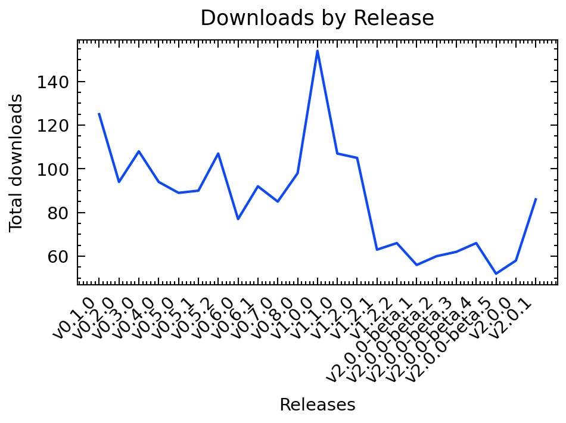
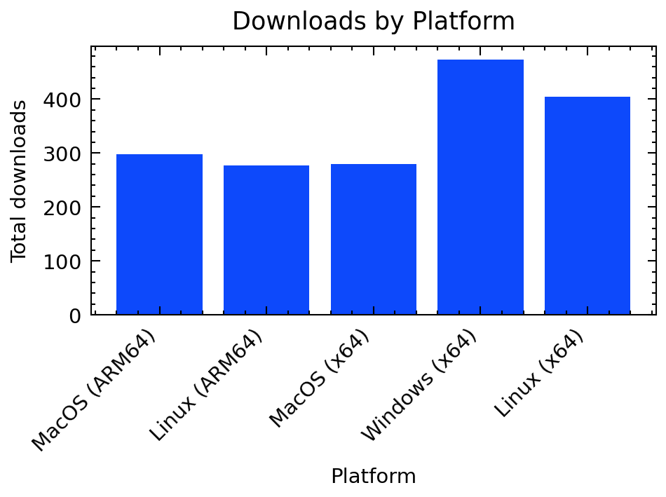
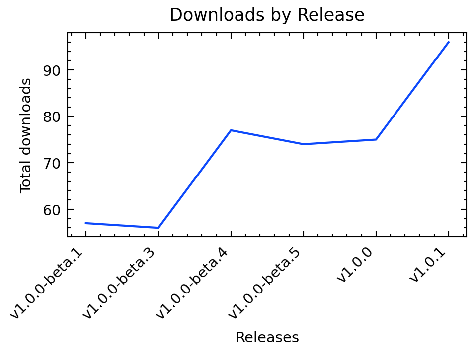
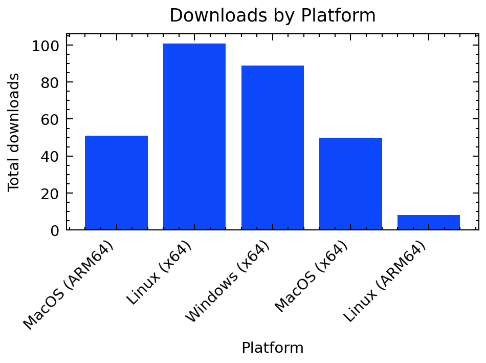
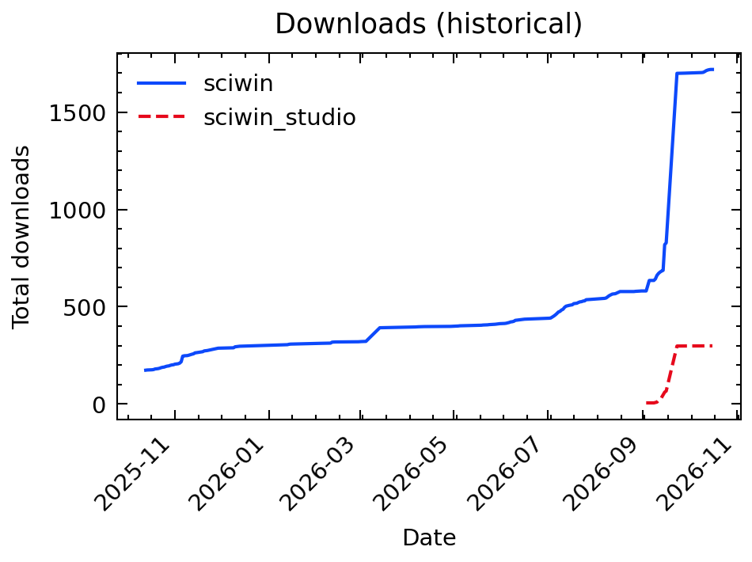

# Metrics for SciWIn
The Metrics shown below have been calculated using the GitHub API for each of the 2 SciWIn projects tracked in this repository. Presentation is done via a CWL Workflow and the scripts in this repository.

## SciWIn-Client

SciWIn-Client helps users creating **Computational Workflows** in CWL. Detailed information about SciWIn-Client can be found in the [GitHub Repository](https://github.com/fairagro/sciwin).

### Downloads by Version
SciWIn-Client currently has about 2164 overall downloads across all versions and operating systems. The latest version v2.0.1 currently has 98 downloads.

| Version | Downloads |
|---------|-----------|
| v2.0.1 | 98|
| v2.0.0 | 65|
| v2.0.0-beta.5 | 60|
| v2.0.0-beta.4 | 72|
| v2.0.0-beta.3 | 68|
| v2.0.0-beta.2 | 66|
| v2.0.0-beta.1 | 62|
| v1.2.2 | 72|
| v1.2.1 | 69|
| v1.2.0 | 111|
| v1.1.0 | 116|
| v1.0.0 | 161|
| v0.8.0 | 104|
| v0.7.0 | 93|
| v0.6.1 | 100|
| v0.6.0 | 84|
| v0.5.2 | 115|
| v0.5.1 | 98|
| v0.5.0 | 97|
| v0.4.0 | 102|
| v0.3.0 | 116|
| v0.2.0 | 102|
| v0.1.0 | 133|

### Downloads by Operating System
There are 741 downloads of the Linux build, 506 downloads of the Windows build and 624 downloads of the macOS build.

| Platform | Downloads |
|---------|-----------|
| MacOS (ARM64) | 321|
| Linux (ARM64) | 300|
| MacOS (x64) | 303|
| Windows (x64) | 506|
| Linux (x64) | 441|

## SciWIn-Studio

SciWIn-Studio is the desktop application for SciWIn, available for Windows, macOS and Linux. Detailed information about SciWIn-Studio can be found in the [GitHub Repository](https://github.com/fairagro/sciwin_studio).

### Downloads by Version
SciWIn-Studio currently has about 435 overall downloads across all versions and operating systems. The latest version v1.0.1 currently has 96 downloads.

| Version | Downloads |
|---------|-----------|
| v1.0.1 | 96|
| v1.0.0 | 75|
| v1.0.0-beta.5 | 74|
| v1.0.0-beta.4 | 77|
| v1.0.0-beta.3 | 56|
| v1.0.0-beta.1 | 57|

### Downloads by Operating System
There are 121 downloads of the Linux build, 98 downloads of the Windows build and 113 downloads of the macOS build.

| Platform | Downloads |
|---------|-----------|
| MacOS (ARM64) | 57|
| Linux (x64) | 112|
| Windows (x64) | 98|
| MacOS (x64) | 56|
| Linux (ARM64) | 9|

## Historical Download Chart
The historical download chart below shows how the 2599 combined downloads across all tracked projects progressed over time, using the commited data of this repository.

