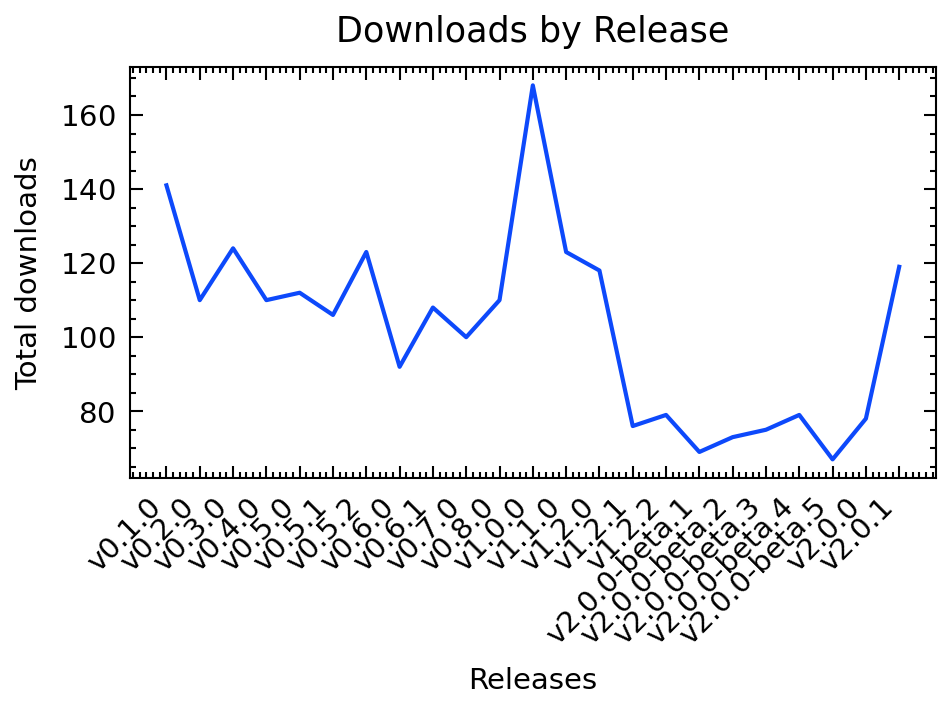
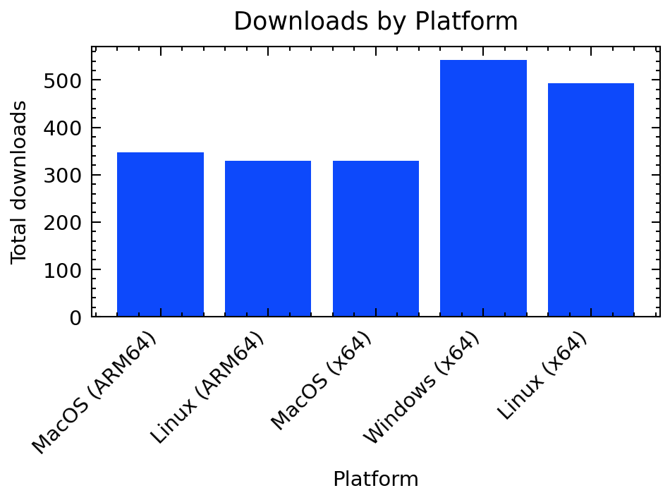
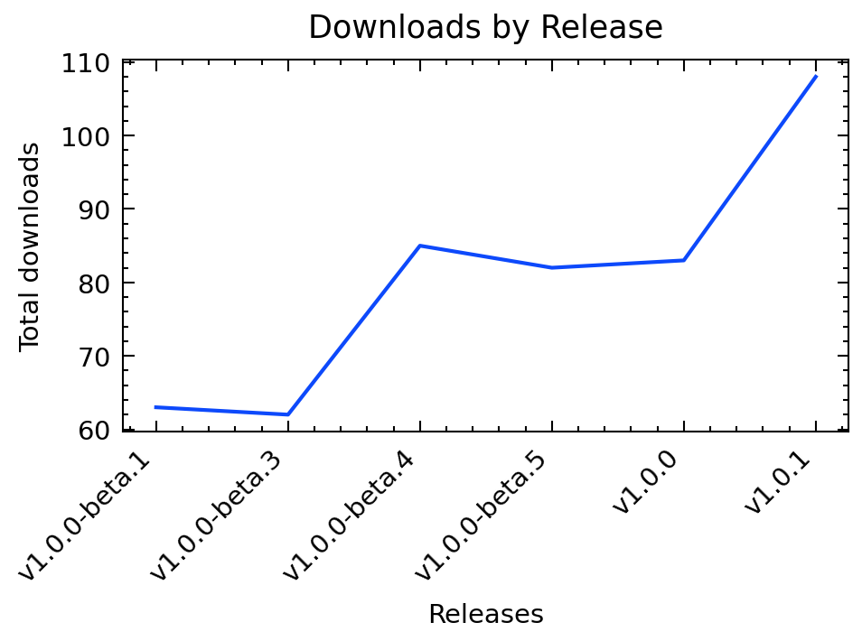
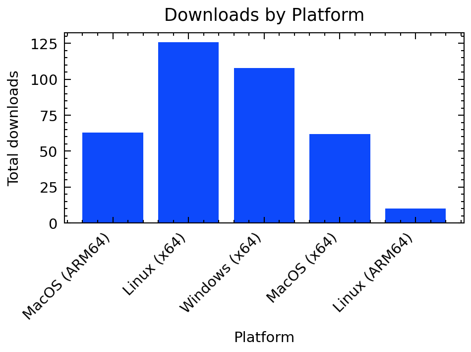
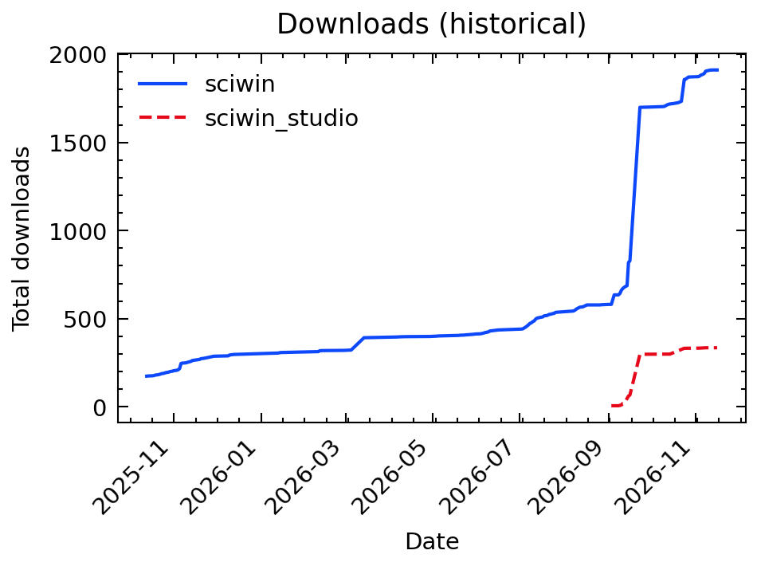

# Metrics for SciWIn
The Metrics shown below have been calculated using the GitHub API for each of the 2 SciWIn projects tracked in this repository. Presentation is done via a CWL Workflow and the scripts in this repository.

## SciWIn-Client

SciWIn-Client helps users creating **Computational Workflows** in CWL. Detailed information about SciWIn-Client can be found in the [GitHub Repository](https://github.com/fairagro/sciwin).

### Downloads by Version
SciWIn-Client currently has about 2360 overall downloads across all versions and operating systems. The latest version v2.0.1 currently has 119 downloads.

| Version | Downloads |
|---------|-----------|
| v2.0.1 | 119|
| v2.0.0 | 78|
| v2.0.0-beta.5 | 67|
| v2.0.0-beta.4 | 79|
| v2.0.0-beta.3 | 75|
| v2.0.0-beta.2 | 73|
| v2.0.0-beta.1 | 69|
| v1.2.2 | 79|
| v1.2.1 | 76|
| v1.2.0 | 118|
| v1.1.0 | 123|
| v1.0.0 | 168|
| v0.8.0 | 110|
| v0.7.0 | 100|
| v0.6.1 | 108|
| v0.6.0 | 92|
| v0.5.2 | 123|
| v0.5.1 | 106|
| v0.5.0 | 112|
| v0.4.0 | 110|
| v0.3.0 | 124|
| v0.2.0 | 110|
| v0.1.0 | 141|

### Downloads by Operating System
There are 822 downloads of the Linux build, 543 downloads of the Windows build and 676 downloads of the macOS build.

| Platform | Downloads |
|---------|-----------|
| MacOS (ARM64) | 347|
| Linux (ARM64) | 329|
| MacOS (x64) | 329|
| Windows (x64) | 543|
| Linux (x64) | 493|

## SciWIn-Studio

SciWIn-Studio is the desktop application for SciWIn, available for Windows, macOS and Linux. Detailed information about SciWIn-Studio can be found in the [GitHub Repository](https://github.com/fairagro/sciwin_studio).

### Downloads by Version
SciWIn-Studio currently has about 483 overall downloads across all versions and operating systems. The latest version v1.0.1 currently has 108 downloads.

| Version | Downloads |
|---------|-----------|
| v1.0.1 | 108|
| v1.0.0 | 83|
| v1.0.0-beta.5 | 82|
| v1.0.0-beta.4 | 85|
| v1.0.0-beta.3 | 62|
| v1.0.0-beta.1 | 63|

### Downloads by Operating System
There are 136 downloads of the Linux build, 108 downloads of the Windows build and 125 downloads of the macOS build.

| Platform | Downloads |
|---------|-----------|
| MacOS (ARM64) | 63|
| Linux (x64) | 126|
| Windows (x64) | 108|
| MacOS (x64) | 62|
| Linux (ARM64) | 10|

## Historical Download Chart
The historical download chart below shows how the 2843 combined downloads across all tracked projects progressed over time, using the commited data of this repository.

